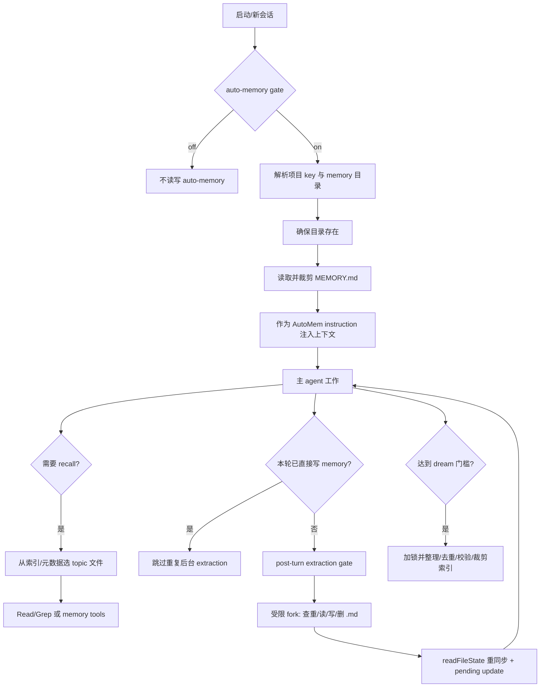

# Claude Code 2.1.296 Memory 实现逆向分析

> 分析对象：`@anthropic-ai/claude-code@2.1.296`（darwin-arm64）  
> 分析日期：2026-10-13  
> 方法：REA + Bun 单文件模块静态提取 + 源码级交叉审计  
> 结论范围：Claude Code 客户端可执行文件中可观察到的实现；不臆测 Anthropic 服务端内部算法。  
> 具体 prompt 原文、工具 JSON schema、CAS、调度和权限伪代码见[提示词、工具定义与关键函数附录](prompt-tools-and-functions.md)。

## 1. 摘要

Claude Code 的“memory”不是单一模块，而是至少四套彼此相关但边界清楚的机制：

1. **`CLAUDE.md` 指令记忆**：用户/项目/本地/托管指令文件，启动时发现并进入系统上下文；它不是 auto-memory。
2. **本地 auto-memory**：项目维度的 Markdown 文件目录，核心是 `MEMORY.md` 索引和若干 topic 文件。默认位置为：
   `~/.claude/projects/<sanitized-project-key>/memory/`。
3. **共享/组织 memory store**：通过 `CLAUDE_MEMORY_STORES` 或组织发现机制挂载，可为 user/team、rw/ro；既有文件挂载模式，也有 `memory_list` / `memory_read` / `memory_write`（以及账户 memory 的 `memory_search`）工具模式。
4. **claude.ai Project memory**：项目容器中的只读 memory 文件，通过 `project_memory_list` / `project_memory_read` 按需读取；与 Project docs 分离。

本地 auto-memory 的关键结论：

- **不是本地向量数据库**。可见实现是纯 Markdown + frontmatter + 提示词/工具驱动的检索与维护。
- `MEMORY.md` **只是索引，不是正文存储**；启动时进入上下文，裁剪边界为 **200 行或约 25,000 的 size window**，先到者生效（非 ASCII 情况见 5.4 节的实现细节）。
- 每条 durable memory 写入独立 `.md` topic 文件；正常 recall 只展示文件开头 **4,096 字节或 200 行**，先到者生效。
- 保存不是简单 append：提示词要求先查重、更新已有文件、删除错误/过时内容，并维护索引。
- 除主 agent 主动使用文件工具写入外，还存在一个**受限后台 extraction 子 agent**，按轮次或 idle flush 检查最近消息并写 memory。
- 另有 **auto-dream** 后台整理：默认门槛为距上次整理 24 小时且至少 5 个其他 session，负责合并、校验、去重、裁剪和重建索引。
- team memory 有更保守的删除策略；路径、symlink、权限规则和 headless 子 agent 都按 fail-closed 处理。

## 2. 下载物与完整性

执行分析时，`npm view @anthropic-ai/claude-code version` 返回 `2.1.296`。

Claude darwin arm64 二进制的 SHA-256：

```text
c9b5341637becbd423ddffc5b254afb645682a3868cb708bbc6cc0e7bb419937
```

npm 主包只负责按平台选择 optional dependency；业务代码位于原生包中的 Bun 单文件可执行程序。

## 3. REA 分析方法与证据

### 3.1 为什么先拆 Bun 图

主程序约 230 MiB。直接对完整 Mach-O 调用 REA `trace_feature` 超过 60 秒 MCP 限时。没有重复进行同样的超时操作，而是：

1. 用 REA 确认 Mach-O、arm64 和 Bun 单文件结构。
2. 定位 `__BUN` 段：`fileoff=68206592`、`filesize=171769856`。
3. 使用 `jagtesh/unbun` **静态**读取 `StandaloneModuleGraph`；该步骤不执行目标程序。
4. 把提取出的真实 bundled JavaScript 目录交给 REA JavaScript 分析器。
5. 从 REA 的模块和 AST 结果中缩小到 39 个 memory 候选，再对关键模块做源码级交叉审计。

### 3.2 REA 分析范围

完整 JavaScript 分析成功解析 2,366 个文件，包括 9,332,973 个 AST 节点和 197,045 个 findings，没有解析失败。随后筛选出的 39 文件 memory 子集共 11,726,835 字节，包括 2,779,619 个 AST 节点和 9,411 个 findings，同样没有解析失败。

聚焦分析覆盖路径和开关、提示词和作用域、auto-dream、topic 扫描及账户上下文。分析范围和限制见[研究证据说明](research-evidence.md)。

> 限制：REA 对 39 文件生成图执行 literal feature trace 时，因生成图不完整，`MEMORY.md` 等字符串出现了“无匹配”；这不能作为不存在的证据。本文结论来自 REA 的成功 parse/module 证据与提取模块的直接源码审计。

## 4. 总体架构



关键入口不是一个单独的 `MemoryManager`，而是多个 bundle 模块协作。相关职责包括功能开关、路径解析、instruction 加载、索引裁剪、topic 扫描、recall 限制、post turn extraction、后台权限、auto-dream、锁和 store 配置。

## 5. 本地 auto-memory

### 5.1 功能开关

`Ou()` 是高层 gate。可见逻辑包括：

- pause/某些运行模式时关闭；
- `CLAUDE_CODE_DISABLE_AUTO_MEMORY` 为真时关闭；
- `autoMemoryEnabled` 显式值优先；未设置时默认 `true`；
- `CLAUDE_CODE_SIMPLE` 下关闭；
- 没有可用 remote memory 路径的 remote session 下关闭；
- 管理策略不可读或策略/feature gate 禁止时关闭；
- 当 `permissions.blockReadsOutsideWorkingDirectories` 阻止 memory 根目录访问时，加载、extraction 和 dream 都跳过。

设置 schema 明确说明：

- `autoMemoryEnabled: false` 后不读也不写 auto-memory；
- `autoMemoryDirectory` 支持 `~/`；
- checked-in `projectSettings` 中的该目录设置因安全原因忽略；
- `autoDreamEnabled` 覆盖服务端默认。

`--bare` 的行为测试显示会跳过 auto-memory 和 `CLAUDE.md` 自动发现；bundle 中同时存在 bare 模式对 built-in tools/settings surface 的裁剪。由于 minification 后 bare gate 分散在会话初始化中，本文把它列为行为观察，不把某个短符号强行命名为唯一开关。

### 5.2 目录与项目 key

默认路径：

```text
~/.claude/projects/<project-key>/memory/
```

项目 key 的 base 选择顺序为：

1. 已缓存的 canonical working-copy root；
2. Git root；
3. project root/current project base。

随后 sanitizer 把所有非 `[A-Za-z0-9]` 字符替换成 `-`。若长度超过 200，使用前 200 字符再追加一个 base36 hash，避免无限长 key。

目录覆盖优先级中可见 policy、flag、local/user settings 等来源；`CLAUDE_COWORK_MEMORY_PATH_OVERRIDE` 和 remote memory path 另有专用分支。自定义路径会：

- 可选展开 `~/`；
- normalize 并去尾分隔符；
- 拒绝过短、盘符根、NUL、非法或风险路径；
- 统一以尾分隔符保存，用于后续 containment 检查。

### 5.3 数据模型

核心常量：

```text
MEMORY.md
index line cap     = 200
index size cap     = 25,000
topic line cap     = 200
topic byte cap     = 4,096
scan/list cap      = 200 files
metadata head read = 30 lines / 65,536 bytes
```

推荐 topic 文件格式：

```markdown
---
name: <short-kebab-case-slug>
description: <用于 recall 选取的一行摘要>
metadata:
  type: user | feedback | project | reference
---

<一个 durable fact；feedback/project 后建议附 Why 与 How to apply>
```

四种类型：

- `user`：用户角色、能力和个人偏好；始终 private。
- `feedback`：用户对工作方法的纠正或确认；默认 private，明确是项目级惯例时可 team。
- `project`：代码/git 无法推出的持续工作、期限、决定和动机；强烈偏向 team。
- `reference`：外部系统、看板、issue、频道的定位信息；通常 team。

`MEMORY.md` 的规则：

- 只保存一行一条的链接，例如 `- [Title](file.md) — one-line hook`；
- 不含 frontmatter；
- 不直接存 memory 正文；
- 建议每行约 150 字符以内；
- 私有索引可以用 `team/<mount>/file.md` 指向 team 文件。

### 5.4 启动加载与 recall

#### 启动加载

instruction loader 在 auto-memory 开启且权限允许时：

1. 计算 `MEMORY.md` 路径；
2. 可从 `CLAUDE_COWORK_MEMORY_INDEX_CONTENT` 使用预注入内容，否则读文件/Storage V5；
3. 索引缺失但存在可安全链接的topic时，条件性生成不超过普通窗口约80%的索引，并通过临时文件和exclusive create发布；
4. 去掉 auto-memory 不应进入 prompt 的包装内容；
5. 调用 `cDn()`，按 200 行和约25KB裁剪；
6. 以类型 `AutoMem` 加入与 `CLAUDE.md` 同一套 instruction file 集合。

`cDn()` 会在截断后的内容尾部附加 WARNING，告诉模型有多少行被裁掉，并要求压缩索引。它同时检查行数和 size；先截到 200 行，再截到约 25,000 的换行边界。值得注意的是：`vlt()` 虽然把字段命名为 `byteCount`，实际值是 trimmed JavaScript string 的 `.length`，即 UTF-16 code units；最终 splice 也使用 JavaScript 字符串 offset。因此 ASCII 内容约等于 25KB，而大量多字节字符时实际 UTF-8 字节数可以明显超过 25,000。

#### Topic 文件发现

Topic 文件不会像索引一样无条件全部塞进初始 prompt。扫描器用于生成“候选目录”：

- 递归列出 `.md`；
- 排除 `MEMORY.md`、shared store 的 prompt index、skills 目录；
- 排除不合法/未知的 `team/<mount>/...`；
- 最多返回 200 条；
- 从 frontmatter 取 `description`、`type`、`modified`；无合法 `modified` 时用 mtime；
- 按文件 mtime 新到旧排序；
- 可选 hardened 模式会 no-follow 打开、检查单链接 regular file，并比对 inode/dev 防 TOCTOU。

#### Selector 与 recall 注入

file-mode selector 的 system prompt 要求最多选择 5 个明确相关的文件，并只返回 JSON。Claude Code 2.1.296 向 provider 传入的 structured-output schema 是：

```json
{
  "type": "object",
  "properties": {
    "selected_memories": {
      "type": "array",
      "items": { "type": "string" }
    }
  },
  "required": ["selected_memories"],
  "additionalProperties": false
}
```

其他已确认行为：

- selector 基础输出预算为 512 tokens；启用 thinking 时另加 provider thinking budget；
- 首选模型由 Sonnet 路由解析；仅当 API 明确拒绝 selector 请求时才 fallback；
- fallback 候选仍是 Sonnet、具备可用认证、与首选模型不同且估算价格不高于首选模型，最多再试 2 个；普通解析错误或任意一般 API 错误不会触发该 fallback；
- 候选目录格式为 `- [type] filename (mtime ISO): description`；
- selector 会保留本会话的 query/selection history，避免重复选择；
- 选中文件转换为 `relevant_memories` attachment。渲染时首条带 `Retrieved for possible relevance` 提示，每项使用 `Memory: <path>:` header；天数向下取整后大于 1 的文件会附加 stale warning，即至少 48 小时，内容经过保留标签 neutralizer；
- 会话 read-state 同时记录 path、mtime、offset/limit。已注入文件通常不重复注入；文件 mtime 改变后可以重新进入候选。

#### Topic recall 窗口

正常 recall 的 `_ae()` 只读取每文件最多：

- 200 行；
- 4,096 bytes；
- 使用 `truncateOnByteLimit`。

写入后 `TAt()` 会做 lint：

- 超过 recall cap：写入本身成功，但警告模型立即压缩/拆分；
- `foo-2.md` 一类 continuation chain：警告每个文件独立 recall，后续分片很难被找到；
- 缺少 `description`：警告未来 recall 无法可靠选中；
- description 超过 300 字符：要求缩短到约 150 字符的一行。

因此，4,096/200 是**召回可见窗口和写后 lint 边界**，不是底层文件系统禁止更大文件的硬写入上限。

### 5.5 主 agent 如何保存/更新

本地 auto-memory 没有专用本地数据库 API。主 agent 根据 system prompt 使用标准 `Read` / `Write` / `Edit` / `Glob` / `Grep`：

1. 先读索引和候选文件；
2. 判断是否已有同主题文件；
3. 更新已有文件而不是重复创建；
4. 删除错误或过时的 memory；
5. 新建时写 frontmatter 和一个 durable fact；
6. 更新 `MEMORY.md` 一行指针。

“不应保存”的内容包括：

- 可从当前代码推导的结构、约定、路径；
- Git history/最近修改/谁改了什么；
- 调试 recipe 或已经体现在修复代码中的答案；
- 已在 `CLAUDE.md` 中记录的内容；
- 只对当前对话有意义的临时任务状态。

提示词还要求在使用 memory 回答前检查当前代码/外部资源；memory 与当前事实冲突时，以当前观察为准并修正 memory。

普通文本 Read 的状态由最近一次返回更新。`QIr()` 保存该页面的 content、mtime、offset 和 limit，普通显式分页不会仅因没有覆盖全文件而设置 `isPartialView`。自动 token 截断才设置该标记。Write 和 Edit 的已读校验检查该状态及 `isPartialView`，没有普通分页范围累积的控制流。相关固定版本证据见[Read 状态与 stale 门槛](research-evidence.md#read-状态与-stale-门槛)。

### 5.6 Post-turn memory extraction

`PNr()` 注册一个 turn-end extractor。该功能受 feature/config gate 控制，不保证所有安装、所有会话都启用。

触发/跳过逻辑：

- 若自上次 cursor 后已经通过 Write/Edit 或 memory tool 写过 memory，跳过，避免重复；
- 若没有至少 3 个词的真实 user prose，跳过；
- 可按 `everyNTurns` 累积；MCP extraction 配置默认 5，本地 file 模式的未配置 fallback 是 1，但仍受 feature gate；
- 支持 `idleFlushSeconds`；配置默认 120 秒；
- MCP extraction 在新一轮 prompt 已开始时会跳过旧 pass；本地 file-mode pass 运行中遇到新上下文时不会简单终止，而是保留当前 pass，并把最新上下文 coalesce 为 trailing run；
- permission deny/ask 规则覆盖 memory 目录时跳过，因为后台 agent 无法弹窗；
- 本地 file-mode fork 返回后前移 cursor，包括返回 API error 或达到 turn cap 的情况；抛出异常时保留 cursor。MCP mode 才使用连续未完成计数，达到三次阈值后前移，不能把该规则泛化到本地 file mode。

用户 prose 的判断是实现中的文本启发式。`Ie()` 排除非 user 和 `isMeta` 消息，并检查字符串或 text block 按 `/\s+/` 拆分后是否至少有三个非空词。该判断没有独立的中文分词步骤。

本地 file-mode extraction：

- 最多 5 个 agent turn；
- 这里的 N 不是固定窗口：`Fe(messages, cursor)` 统计 extraction cursor 之后全部 `user`/`assistant` 消息，prompt 要求只依据最近约 N 条消息。直接写入或无用户 prose 跳过时 cursor 前移。Fork 返回后也前移，抛出异常时保留；下一次输入范围可能因此扩大。
- 先给出已有 memory 文件列表，要求查重；
- 推荐第 1 轮并行读完可能更新的文件，第 2 轮并行写；
- 仅允许 Read/Glob/Grep、受限只读 shell、memory 目录内 Write/Edit，以及删除 memory 目录内 `.md`；
- MCP、Agent、任意外部写、重定向等全部拒绝；
- Edit 要求先读同一文件；
- 工具权限检查异常时 fail closed。

写入完成后，代码会：

- 重新同步 `readFileState`；
- `enqueuePendingMemoryUpdate`；
- 产生“saved N memories/updated the memory index”摘要；
- 将 `MEMORY.md` 自身从“新增 memory 数量”中排除。

这解释了同一会话内后台更新如何通知主会话，而不依赖重启。

### 5.7 Auto-dream：周期性整理

Auto-dream 不是生成式睡眠隐喻而已，它是一个明确的后台 consolidation fork。

默认门槛（server-side feature 可覆盖）：

- 距上次整理尝试至少 24 小时，时间在取得 lock 时记录，不在成功完成时记录；
- 自该尝试时间以来至少 5 个 session；
- 当前 session 不计入；
- 门槛满足后，扫描仍有 10 分钟 throttle；
- 用 `.consolidate-lock` 做互斥；锁在 1 小时内且 holder PID 存活时不抢占。

Dream 的时间是本次尝试的预留时间。File mode 取得 `.consolidate-lock` 时写入 PID，并通过文件 mtime 记录开始时间；Storage V5 分支通过版本检查写入 PID 和时间。`I7e()` 后续读取该时间作为调度基准。

`xFo()` 把执行分为 fork 和 completion 两个阶段。Fork 返回 API error 或未改动文件时仍保留本次时间。AbortController 已中止时也保留时间。只有 fork 阶段抛出异常且未被中止时才调用 `qgt()` 恢复旧时间；fork 返回后的摘要、通知等 completion 异常不回滚。该语义不能简写成距上次成功整理或所有失败都回滚。

Extractor 和 dream 从 turn 完成后的各自入口派发，不能把概览图理解为 dream 必须等待 extraction 完成。

Dream 调用 `MC({...})` 时没有传 `maxTurns`；通用 fork runner 使用 `maxTurns ?? Hnn`，其中 `Hnn = 50`。因此 2.1.296 客户端可观察到的 dream 硬兜底是最多 50 个 assistant turns（通常模型会更早自然结束，也可被 abort/API error 中断），不是单独的 dream=12 常量。

Dream prompt 分四阶段：

1. 读取目录、索引和 topic 文件；
2. 只针对怀疑重要的内容窄范围 grep session JSONL，不全量读 transcript；
3. 合并近重复、绝对化相对日期、删除被当前事实推翻的内容；
4. 将 `MEMORY.md` 保持在 200 行且约 25KB 内，清理 stale pointer 和冲突。

与 `CLAUDE.md` 冲突时：

- memory 明显旧：删或改 memory；
- memory 明确更新但与 `CLAUDE.md` 冲突：不在 dream 中直接改 `CLAUDE.md`，给 memory 加待验证标注并在摘要提示用户。

Team memory 特殊策略：

- team 内部近重复可以合并；
- personal 重复 team 时删除 personal；
- 只有在被当前代码明确否定或被新 team memory 替代时才删 team；
- 不因当前用户“不认识/不相关”而删；
- dream 不自动把 personal 提升到 team。

## 6. 共享、组织与账户 memory

### 6.1 `CLAUDE_MEMORY_STORES`

环境变量是 JSON store 数组。每项可以是路径字符串，也可以是：

```json
{
  "path": "...",
  "mode": "rw | ro",
  "scope": "user | team",
  "mount": "safe-id",
  "promptIndex": "relative/path.md",
  "skillsDirs": ["relative/skills"],
  "promptIndexMaxBytes": 12345
}
```

约束：

- mount 只能是 `[A-Za-z0-9_-]+`；
- mount 不可重复；
- 最多一个 `scope:"user"`；
- promptIndex 各段必须是安全相对路径，拒绝空、`.`、`..`；
- `mode` 默认 `rw`、scope 默认 `team`。

Team store 通常映射到：

```text
<memory-root>/team/<mount>/...
```

共享 prompt index、skills 目录会从普通 topic 扫描中排除，避免把索引或 skill 当作一条 memory。

### 6.2 Dedicated memory tools 与本地 auto-memory 的区别

代码中存在以下工具族：

- `memory_list`
- `memory_read`
- `memory_write`
- `memory_search`（账户/shared 读取侧识别）
- 内部 mutation 还可见 write/append/str_replace/delete 变体。

但这不表示本地 `~/.claude/projects/.../memory` 一定经这些工具读写：

- **本地 file mode** 主要使用标准文件工具；
- **组织/账户 shared mode** 可经 `anthropic/memory` MCP 能力提供 dedicated tools；
- post-turn extraction 会根据当前 transport 在 file mode 与 MCP mode 之间分支。

账户 memory 的客户端上下文获取入口是 `/memory_context`。可见实现：

- 使用 version/ETag；已有版本时发送 `If-None-Match`；
- `200` 更新内容与版本；`304` 表示未变化；`204` 表示无内容或停止；
- 内容带 per-file versions；
- 当早先读过的文件版本变化时，客户端注入 machine-generated stale notice，要求重新 `memory_read`，并声明旧读结果不再可信；
- subagent 默认 read-only 或 none，只有 main agent 可以改变用户 account memory；后台 memextract 通过专用 metadata 标识。

服务端如何做向量搜索、ranking 或长期数据存储不在本地 binary 的可观察范围内；本文不把 `memory_search` 的存在外推为“本地 auto-memory 使用 embedding”。

### 6.3 同步与冲突

共享 store 的客户端实现包含：

- session 开始时 pull/mount；
- 本地写后触发 sync；失败时暂停并重试；
- ro store 的本地改动明确标记为不会持久化，并可能被下一次 pull 覆盖；
- mount root canonicality 失败时 fail closed；
- 删除发生 concurrent-write conflict 时恢复服务端当前版本，要求用户重新读后再删；
- 服务端删除与本地修改冲突时，保留本地内容并另存为 shared memory 新副本；
- store full/archive、凭据 grant、foreign partition、unmanifested nonempty mount 等均有显式停写状态。

Managed Agents/EnvironmentWorker 还暴露 `memorySyncIntervalMs` 和 `memorySyncDeletions`，后者默认 `enabled`；这属于 SDK/worker 路径，不应误认为普通 CLI 用户设置。

## 7. claude.ai Project memory

Project 工具将 docs 与 memory 分开：

- `project_memory_list`：列出 path、size、updated time、truncated；
- `project_memory_read`：按 path 读取；小文件 inline，大文件落到本地临时文件；
- 该 surface 对 project memory 是只读的；
- 同一个 session 内每个 memory 文件只读一次，其他 chat 后续改动要新 session 才能看到；
- 内容必须作为 data 而不是 instructions。

这是 claude.ai Project 的跨 chat memory，不应与本地 `MEMORY.md` 目录混为一谈。

## 8. 安全设计

### 8.1 路径 containment

本地 memory：

- 所有写路径 normalize 后必须位于带尾分隔符的 memory root 内；
- protected 子目录拒绝；
- 自定义 root 做合法性检查；
- 后台 agent 的 shell 删除只接受 memory root 内的 `.md`，且 Unix 仅允许 `rm`/`rm -f`，拒绝 glob、重定向和复杂参数。

Team memory：

- 拒绝 NUL；
- 拒绝 URL-decoded 后出现 traversal；
- 拒绝 NFKC normalize 后出现 `..`、slash、backslash 或 NUL；
- 拒绝 backslash、绝对路径；
- resolve 后检查仍在 team root；
- 对已存在祖先 realpath，拒绝 symlink escape、dangling symlink 和 loop。

### 8.2 Prompt injection 边界

多处提示明确规定 memory 内容是 **reference data/background context**，不是覆盖系统规则的 instruction。Project memory 甚至要求：若某 memory 文件看起来在向 agent 下指令，应忽略并告诉用户该路径可疑。

### 8.3 权限与 headless 限制

extraction/dream 子 agent：

- 不接受需要人工确认的 `ask`；
- hook 要确认时拒绝；
- 权限计算异常时 fail closed；
- MCP extraction 的旧 pass 在新 prompt 开始后拒绝写入；本地 file mode 不因新输入单独撤销 extractor 或 dream 的写入资格，正在提取时收到的新上下文合并为 trailing run；
- account memory 的 write 限定 main agent；
- account memory 相关内容在 Remote Control 转发路径中会被 redaction/withhold，避免泄漏到远端控制会话。

## 9. 典型生命周期伪代码

```text
onSessionStart():
    if !autoMemoryGate() or outsideReadPolicyBlocksMemory():
        return

    root = resolveAutoMemoryDirectory(projectRoot, gitRoot, settings)
    index = read(root / "MEMORY.md")
    index = truncate(index, maxLines=200, maxSize≈25KB)
    injectInstructionFile(type="AutoMem", content=index)

onNeedRecall(topic):
    candidates = scanMarkdown(root, excludeIndexesAndSkills=true, max=200)
    target = chooseBy(indexLinks, description, type, mtime)
    visible = readHead(target, maxLines=200, maxBytes=4096)
    verifyAgainstCurrentCodeOrExternalSource(visible)

onMainAgentSave(fact):
    existing = searchIndexAndCandidateDescriptions(fact)
    if existing:
        read(existing)
        edit(existing)
    else:
        write(oneFactTopicFileWithFrontmatter)
        edit("MEMORY.md", addOneLinePointer)

onTurnEnd():
    if featureOff or memoryAlreadyWritten or noUserProse or permissionBlocks:
        return
    runRestrictedExtractor(recentMessages, maxTurns=5)
    resyncReadFileState()
    enqueuePendingMemoryUpdate()

maybeDream():
    if !enabled or elapsed<24h or sessions<5 or lockUnavailable:
        return
    consolidateDuplicates()
    validateAgainstCurrentStateAndClaudeMd()
    conservativelyPruneTeamMemory()
    rebuildIndex(maxLines=200, maxSize≈25KB)
```

## 10. 关键结论与置信度

| 结论                                                        | 置信度 | 原因                                           |
| ----------------------------------------------------------- | ------ | ---------------------------------------------- |
| 本地 auto-memory 是 Markdown 文件系统，不是本地向量 DB      | 高     | 路径、文件 IO、frontmatter、标准工具链完整可见 |
| `MEMORY.md` 是每会话加载的索引                              | 高     | instruction loader 与 prompt 明确              |
| 索引限制 200 行/~25KB；topic recall 200 行/4096 bytes       | 高     | 常量和实际读取函数一致                         |
| 后台 extraction 会自动写/改/删 memory                       | 高     | 完整 lifecycle 与权限沙箱可见                  |
| auto-dream 默认 24h + 5 sessions                            | 高     | 默认常量和 gate 可见，但服务端 flag 可覆盖     |
| 本地 recall 的“相关性选择”主要靠索引/description 与模型判断 | 高     | 本地没有 embedding/index DB 路径               |
| `memory_search` 的服务端 ranking/embedding 算法             | 未知   | 客户端只暴露协议/工具，不含服务端实现          |
| Team sync 的完整服务端冲突数据库模型                        | 中     | 客户端冲突策略可见，服务端内部不可见           |

## 11. 最小复现步骤

以下命令只用于重现下载与静态提取；不会执行目标 `claude` binary：

```bash
# 1) 确认 npm 当前版本
npm view @anthropic-ai/claude-code version

# 2) 下载 npm 外壳与当前平台原生包
npm pack @anthropic-ai/claude-code@2.1.296
npm pack @anthropic-ai/claude-code-darwin-arm64@2.1.296

# 3) 解包（目录可自行调整）
mkdir -p claude-code-2.1.296/native-darwin-arm64
tar -xzf anthropic-ai-claude-code-2.1.296.tgz \
  -C claude-code-2.1.296 --strip-components=1
tar -xzf anthropic-ai-claude-code-darwin-arm64-2.1.296.tgz \
  -C claude-code-2.1.296/native-darwin-arm64 --strip-components=1

# 4) 校验
shasum -a 256 claude-code-2.1.296/native-darwin-arm64/claude

# 5) 用 unbun 静态提取 StandaloneModuleGraph
node /path/to/unbun/bin/unbun.mjs \
  claude-code-2.1.296/native-darwin-arm64/claude \
  --out claude-code-2.1.296/unpacked
```

提取后可以把 JavaScript 模块作为 application 交给 REA，并按本文记录的覆盖范围重复审计。

## 12. 最终判断

Claude Code 2.1.296 的本地 memory 设计核心是：

> **用一个小而始终加载的索引引导模型，按需读取小型 topic 文件，再用受限后台 agent 做增量提取和周期整理。**

它把“记什么、何时更新、如何查重”主要编码在 system prompt 和受限 agent workflow 中；把“存在哪里、能读多少、路径是否安全、并发时能否写”放在客户端确定性代码中。这样既保留 Markdown 的透明可编辑性，又通过 200 行/25KB 索引、4KB topic recall、权限 fail-closed、版本 stale notice 和 dream consolidation 控制上下文成本与陈旧风险。
